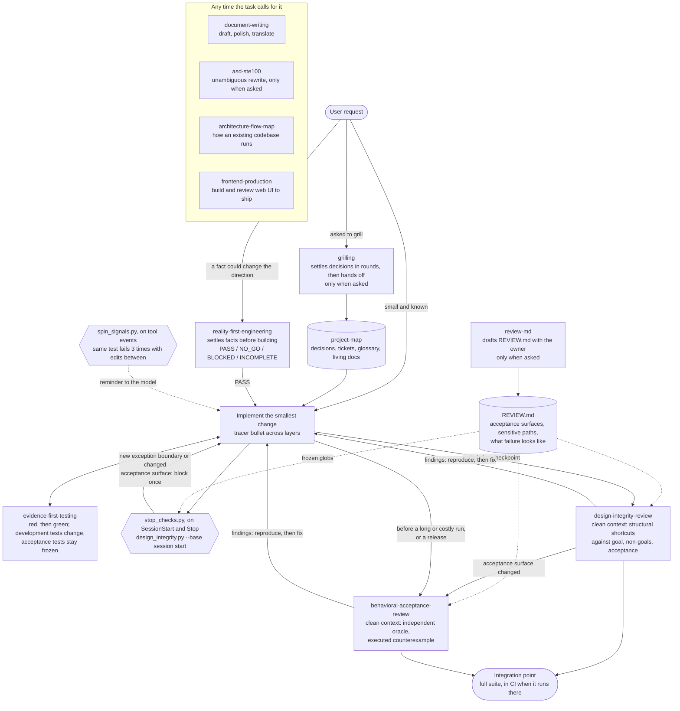

# Agent Skills Index

English · [简体中文](README.zh-CN.md)

A catalog of reusable Skills maintained by `a1024053774`. Each Skill keeps its own canonical
repository and release history; this repository provides one stable discovery and installation
entry point without copying Skill code or creating synchronization drift. It also holds the two
[hooks](#hooks) that run the Skills' checks, because they call Skills from more than one repository.

The catalog contains **11 Skills from 8 source repositories**. Last reviewed: **2026-10-15**.
The source revisions below matched each repository's remote `main` on that date, except
`asd-ste100`, added on 2026-10-31: its revision matched its remote `master` that day; and
`reality-evidence-engineering` and `design-integrity-guardrails` (which added `review-md`),
updated on 2026-11-04: their revisions matched their remote `main` that day. Archived copies are
not catalog entries.

## How the Skills work together

Each box is one Skill or hook and the one job it owns. Solid arrows are the usual order of work;
dotted arrows are what a Skill or hook reads.



Reviews run in a fresh context and get the task's goal, non-goals, and acceptance condition, not
the implementer's rationale; a reviewer that inherits the rationale tends to confirm it. Review
depth is set by the change, not the author: docs and copy need none, ordinary code follows the
routing below, and sensitive paths or acceptance surfaces in `REVIEW.md` get both reviews and the
owner's approval.

## Choose a Skill

| Situation | Skill | Boundary |
| --- | --- | --- |
| A consequential direction depends on an unverified fact | `reality-first-engineering` | Settle the fact with a small probe before broad implementation; skip routine, known work |
| The user explicitly asks for grilling | `grilling` | Compare choices, track assumptions behind accepted recommendations, and stop at a human-confirmed handoff |
| A long-running project needs durable decisions and current docs | `project-map` | Use an existing map or create one when asked; plan the next two or three vertical build tickets and work one per session |
| A bug fix or behavior change needs credible regression evidence | `evidence-first-testing` | Preserve the failure and show the same signal rejects bad behavior and accepts the repair; reproduce review findings before fixing them; search ordering contracts in a small scope |
| A change adds structural risk | `design-integrity-review` | Review once in a fresh context against the goal, non-goals, and acceptance condition; each failure names an input that reaches it; route acceptance-surface changes to behavioral review |
| A long or costly run or a release relies on tests, evals, or generated artifacts, or an acceptance surface changed | `behavioral-acceptance-review` | Require an independent oracle, evidence from the boundary being claimed, and an executed counterexample for each failure |
| The user asks for a repository's `REVIEW.md` | `review-md` | Run only when asked; list candidates from the code, ask the owner only what the code cannot answer, save after approval |
| The reader needs to understand how an existing codebase runs | `architecture-flow-map` | Trace current behavior into `map.json` and an interactive HTML map; do not draw a proposed design as fact |
| A document needs drafting, polishing, or translation | `document-writing` | Preserve meaning, qualifications, and encoding across languages |
| The user asks for a given text to be made unambiguous for a model or a non-native reader | `asd-ste100` | Run only when asked; rewrite the given English or Simplified Chinese text and keep every fact and hedge; never restyle the agent's own output |
| A web frontend must be built or reviewed to ship | `frontend-production` | Start from the audience, primary action, and real content; keep the project's tokens; review read-only with P0–P3 and evidence limits |

Use the relevant Skills, not a mandatory eleven-step pipeline. `grilling` settles human decisions;
`reality-first-engineering` settles uncertain facts; `project-map` holds persistent project state.
`evidence-first-testing` supplies regression evidence during implementation. At a completion
checkpoint, `design-integrity-review` reviews a frozen candidate in a fresh context. Before a long
or costly run or a release, `behavioral-acceptance-review` audits the evidence that run relies on,
also on a frozen candidate in a fresh context. `review-md` writes down what they judge against. A handoff is not
authorization to build.

## Catalog

### Reality and evidence

- [`reality-first-engineering`](https://github.com/a1024053774/reality-evidence-engineering/tree/main/reality-first-engineering)
  — establish a fact-backed direction gate before consequential implementation.
- [`evidence-first-testing`](https://github.com/a1024053774/reality-evidence-engineering/tree/main/evidence-first-testing)
  — preserve red-state evidence and prove that tests detect the intended behavior.

Source repository: [reality-evidence-engineering](https://github.com/a1024053774/reality-evidence-engineering)

### Design integrity and acceptance

- [`design-integrity-review`](https://github.com/a1024053774/design-integrity-guardrails/tree/main/design-integrity-review)
  — review one change in a fresh context against its goal, non-goals, and acceptance condition for structural shortcuts; route acceptance-surface changes to behavioral review.
- [`behavioral-acceptance-review`](https://github.com/a1024053774/design-integrity-guardrails/tree/main/behavioral-acceptance-review)
  — independently audit tests, evals, generated artifacts, and user-visible workflows, including release verdicts for Agent products.
- [`review-md`](https://github.com/a1024053774/design-integrity-guardrails/tree/main/review-md)
  — when explicitly invoked, draft or update a repository's `REVIEW.md` with its owner: frozen acceptance surfaces, sensitive paths, what failure looks like, and paths to skip.

Source repository: [design-integrity-guardrails](https://github.com/a1024053774/design-integrity-guardrails)

### Decisions and project state

- [`grilling`](https://github.com/a1024053774/grilling-skill/tree/main/grilling)
  — when explicitly invoked, stress-test decisions in rounds, track the assumptions behind accepted recommendations, and stop at a human-confirmed handoff.
- [`project-map`](https://github.com/a1024053774/project-map-skill/tree/main/project-map)
  — keep a project's decisions, tickets, glossary, and living docs in a small local map; carry work from
  decisions to a spec, tracer-bullet build tickets, and one ticket per session; catch stale docs.

Source repositories: [grilling-skill](https://github.com/a1024053774/grilling-skill) · [project-map-skill](https://github.com/a1024053774/project-map-skill)

### Understanding a codebase

- [`architecture-flow-map`](https://github.com/a1024053774/architecture-flow-map-skill/tree/main/architecture-flow-map)
  — trace current modules, business objects, and 3–5 scenarios into `map.json` and an interactive HTML map;
  validate code references during the build and check the viewer in a browser.

Source repository: [architecture-flow-map-skill](https://github.com/a1024053774/architecture-flow-map-skill)

### Writing

- [`document-writing`](https://github.com/a1024053774/document-writing-skill/tree/main/document-writing)
  — draft, polish, or translate documents with natural target-language prose, semantic fidelity, and encoding protection.
- [`asd-ste100`](https://github.com/a1024053774/asd-ste100)
  — when explicitly invoked, rewrite a given English or Simplified Chinese text into ASD-STE100-style controlled
  language so a model cannot misread it, keeping every fact and hedge. A fork of
  [danyuchn/asd-ste100-skill](https://github.com/danyuchn/asd-ste100-skill) with Chinese rules adapted from
  [dualface/ste-zh](https://github.com/dualface/ste-zh).

Source repositories: [document-writing-skill](https://github.com/a1024053774/document-writing-skill) · [asd-ste100](https://github.com/a1024053774/asd-ste100)

### Frontend

- [`frontend-production`](https://github.com/a1024053774/frontend-production-skill/tree/main/frontend-production)
  — build and review web frontends to ship: product voice and visual direction, one visual family,
  motion, mobile web, and page-by-page engineering review. Replaces `frontend-less-ai-tone` and `same-visual-family`, whose repositories are archived.

Source repository: [frontend-production-skill](https://github.com/a1024053774/frontend-production-skill)

## Install examples

Install one Skill globally:

```bash
npx skills add a1024053774/grilling-skill --skill grilling -g -y
```

Install a Skill from the other source repositories:

```bash
npx skills add a1024053774/reality-evidence-engineering --skill reality-first-engineering -g -y
npx skills add a1024053774/reality-evidence-engineering --skill evidence-first-testing -g -y
npx skills add a1024053774/design-integrity-guardrails --skill design-integrity-review -g -y
npx skills add a1024053774/design-integrity-guardrails --skill behavioral-acceptance-review -g -y
npx skills add a1024053774/design-integrity-guardrails --skill review-md -g -y
npx skills add a1024053774/project-map-skill --skill project-map -g -y
npx skills add a1024053774/architecture-flow-map-skill --skill architecture-flow-map -g -y
npx skills add a1024053774/document-writing-skill --skill document-writing -g -y
npx skills add a1024053774/asd-ste100 --skill asd-ste100 -g -y
npx skills add a1024053774/frontend-production-skill --skill frontend-production -g -y
```

The machine-readable catalog is [`skills.json`](skills.json). Keep this index limited to links,
metadata, and install coordinates; changes to Skill behavior belong in the canonical source repo.

These examples use the explicit `--skill` selector documented by the
[Skills CLI](https://github.com/vercel-labs/skills). They install from the source repository's
current default branch, not from the reviewed snapshot below.

## Reviewed source revisions

These are Git snapshots, not semantic release versions. `reviewed_at` records the catalog review
date, and each entry's `source_revision` records the full source-repository commit. Updating these
fields does not pin installation or certify a Skill's runtime behavior.

| Source repository | Reviewed commit | Skills |
| --- | --- | --- |
| [reality-evidence-engineering](https://github.com/a1024053774/reality-evidence-engineering) | [`d52db57`](https://github.com/a1024053774/reality-evidence-engineering/tree/d52db5737fa242db8a56ebcc71851d3462157f64) | `reality-first-engineering`, `evidence-first-testing` |
| [design-integrity-guardrails](https://github.com/a1024053774/design-integrity-guardrails) | [`facc7c1`](https://github.com/a1024053774/design-integrity-guardrails/tree/facc7c1799921d6f4206b066c8161c468fe8a54b) | `design-integrity-review`, `behavioral-acceptance-review`, `review-md` |
| [grilling-skill](https://github.com/a1024053774/grilling-skill) | [`f1e01bb`](https://github.com/a1024053774/grilling-skill/tree/f1e01bb6b94deb15769eee552125535c2c80ef42) | `grilling` |
| [project-map-skill](https://github.com/a1024053774/project-map-skill) | [`c16779a`](https://github.com/a1024053774/project-map-skill/tree/c16779a296f43a91b20da2cabbe70223a7569f9a) | `project-map` |
| [architecture-flow-map-skill](https://github.com/a1024053774/architecture-flow-map-skill) | [`8b3a0c5`](https://github.com/a1024053774/architecture-flow-map-skill/tree/8b3a0c5df60ee762461b39613614741b2f715f4b) | `architecture-flow-map` |
| [document-writing-skill](https://github.com/a1024053774/document-writing-skill) | [`5fc4ea0`](https://github.com/a1024053774/document-writing-skill/tree/5fc4ea0cacfb9d1dd331a772ee0b34120799ec48) | `document-writing` |
| [asd-ste100](https://github.com/a1024053774/asd-ste100) | [`d2f2d77`](https://github.com/a1024053774/asd-ste100/tree/d2f2d775c35c7aee861c96ed7e46569c993a8c69) | `asd-ste100` |
| [frontend-production-skill](https://github.com/a1024053774/frontend-production-skill) | [`b291300`](https://github.com/a1024053774/frontend-production-skill/tree/b2913002abd3767c1e9272201568695e58232e48) | `frontend-production` |

## Local checkouts and the skill hub

When you develop the Skills locally, keep one checkout per source repository under one folder
(default `~/Documents/SKILLS/<repository>`) and use `~/.agents/skills` as the hub. Codex, Cursor,
Gemini CLI, and Factory read the hub directly; Claude Code reads only `~/.claude/skills`, so it gets
links into the hub, and WorkBuddy, Trae, Qoder, and Kiro get links to the Skills listed for them. [`scripts/sync_skills.py`](scripts/sync_skills.py) reconciles this layout from
`skills.json`:

```bash
python3 scripts/sync_skills.py            # dry run: print the link changes
python3 scripts/sync_skills.py --apply    # apply them
```

It links catalog Skills from your checkouts into the hub, mirrors the hub into `~/.claude/skills`,
and removes symlinks in hub-reading directories that would list a Skill twice or that are broken.
Real directories are only reported, never moved. Edit `MIRRORS` and `HUB_READERS` at the top of
the script if your harness set differs.

## Hooks

A Skill's script runs only when the model remembers to run it; a hook runs every time. The check
logic stays in the Skills' own scripts, one copy each, and the hooks in [`hooks/`](hooks) only call
them at the right moment. They live here because `stop_checks.py` calls Skills from two
repositories (`design-integrity-review` and `project-map`).

| Hook | Events | What it does |
| --- | --- | --- |
| [`stop_checks.py`](hooks/stop_checks.py) | `SessionStart`, `Stop` (Claude Code and Codex) | On `SessionStart`, records `HEAD` as the session base in `<git-dir>/agent-session-base/<session_id>`, once, so a resumed session keeps it. On `Stop`, runs `design_integrity.py --base <that commit>` and, in a repository with `.project-map/`, `project_map.py status`. Each new item blocks the stop once: an added exception boundary, a changed acceptance surface (an acceptance test is frozen during implementation), a structural map problem, or a stale living doc. |
| [`spin_signals.py`](hooks/spin_signals.py) | `PostToolUse`, `PostToolUseFailure`, `PostCompact` (Claude Code) | Tells the model, not the user, when the session may be spinning: the same test command failed 3 times in a row with edits in between, tests regressed twice (a test command failed after a test had passed), or the context was compacted twice. Many edits with no test run is normal feature work and does not count. |

Install by linking them from this checkout, then register them:

```bash
mkdir -p ~/.claude/hooks
for f in stop_checks.py spin_signals.py; do ln -sfn "$PWD/hooks/$f" ~/.claude/hooks/$f; done
```

- **Claude Code** (`~/.claude/settings.json`): `python3 "$HOME/.claude/hooks/stop_checks.py"` under
  `SessionStart` and `Stop`; `python3 "$HOME/.claude/hooks/spin_signals.py"` under `PostToolUse`
  (matcher `Edit|Write|MultiEdit|NotebookEdit|Bash`), `PostToolUseFailure` (matcher `Bash`), and
  `PostCompact`.
- **Codex** (`~/.codex/hooks.json`, same event names): `stop_checks.py` under `SessionStart` and
  `Stop`. In codex-cli 0.164.0 an untrusted hook is skipped silently in `codex exec`, so trust the
  hooks once in an interactive session, and again whenever the hook command changes.

Each hook has an end-to-end test next to it that feeds it the documented hook payloads:

```bash
bash hooks/stop_checks_e2e.sh
bash hooks/spin_signals_e2e.sh
```

## Instruction budget check

A long `SKILL.md` buries its rules, so each Skill keeps `SKILL.md` short, opens it with the
non-negotiable core, and moves phase-specific detail into `references/` behind a one-line link.
[`scripts/check_skill_budget.py`](scripts/check_skill_budget.py) checks the parts of that contract a
script can check:

```bash
python3 scripts/check_skill_budget.py                         # every catalog Skill under ~/Documents/SKILLS
python3 scripts/check_skill_budget.py ../grilling-skill/grilling   # one Skill folder
python3 scripts/check_skill_budget.py --max-bytes 10240       # a different budget
python3 scripts/check_skill_budget.py --since HEAD --allow rewrites.txt   # also report text lost since HEAD
bash tests/check_skill_budget_e2e.sh                          # acceptance run against fixture Skills
```

| Check | Fails when |
| --- | --- |
| `size` | `SKILL.md` is over `--max-bytes` (default 8192: the files of 9 KB and up were the ones that needed restructuring, those of 3–5 KB were fine), or over the Skill's own `maxBytes` in `skills.json` when it has one. `grilling` has 11264: its question types, map format, and asking rules are used every round, so moving them to `references/` would only make each round reread them. `asd-ste100` has 18432: it is a fork that keeps upstream's `SKILL.md` layout so that upstream changes still merge, so it has not been restructured to the default budget |
| `frontmatter` | there is no frontmatter, `name` is not the folder name, or `description` is empty or over 1024 characters |
| `orphan` | a file under `references/` is not linked from `SKILL.md` itself, by a Markdown link or a code span holding its path |
| `link` | a relative Markdown link (inline, image, or reference definition) points at nothing |
| `escape` | a relative link leaves the Skill folder, which is all an install copies |
| `anchor` | a `#fragment` into a Markdown file names no heading there (GitHub slugs, with `-1`, `-2` for duplicates) and no HTML `id` |
| `lost` | with `--since REV`: a sentence, list item, table row, or code line that `SKILL.md` and `references/*.md` held at `REV` no longer appears as a whole unit, so `Never push to main` turned into `Never push to main unless …`, or `run the tests.` into `never run the tests.`, is reported |

Links are read from `SKILL.md`, `references/**/*.md`, and the Markdown files `SKILL.md` links to;
link text may wrap across lines. Fenced code, inline code, HTML comments, footnotes, and URLs with a
scheme are skipped. Each Skill prints its size and the number of lines before its first `##`
heading, where the core should be. The exit code is 1 when any Skill fails or a catalog Skill has
no local checkout.

`lost` reports every rewrite, including deliberate ones. Review each line; when the rule now lives
elsewhere in other words, copy the reported text (everything after `lost: <file>: `) into the
`--allow` file as one line. A fragment of it does not count.

What it cannot tell you:

- **Misses.** Whether the opening lines really are the core, and whether moved detail is really
  phase-specific. Bytes are a proxy for tokens, and per byte CJK text costs more tokens than
  English, so the budget is lenient for Chinese Skills. HTML `<a href>` links, paths written only
  in backticks, and external URLs are not checked; only `references/` is checked for orphans.
  `lost` compares only `SKILL.md` and `references/`, matches text rather than meaning, and accepts
  a finished sentence that survives verbatim even if a new sentence after it weakens it. A code
  span opened in one list item and closed in the next can hide a link between them.
- **False alarms.** Anchors in setext headings, or in headings with `_emphasis_`, letter-like
  symbols (Ⅻ, Ⓐ), an entity inside inline code, or non-ASCII capitals, can slug differently from
  GitHub. Links in indented (four-space) code blocks are checked. A reference
  reached only through another reference counts as an orphan, because references stay one level
  deep. A link out of the Skill folder fails even when the Skill is only used inside its repository.
  Text moved out of `references/` into another file, or an unpunctuated item merged into a
  sentence, is reported by `lost` and needs an `--allow` line.

## Integration options

This index uses a catalog model: independent repositories plus one discovery layer. It is the
least coupled option and works well when Skills have different release cadences.

Use Git submodules when you need a pinned, checkoutable bundle for a specific project or workshop.
Use a monorepo only when the Skills share code, tests, or a release process and you are willing to
version them together. Do not mirror the same `SKILL.md` in both an index and a source repository;
that creates two competing sources of truth.

## License

MIT. See [LICENSE](LICENSE).
