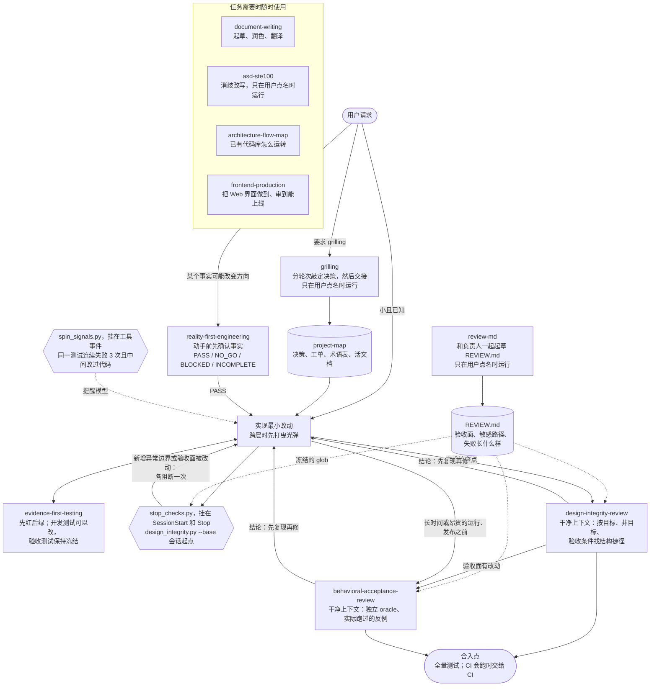

# Agent Skills Index

[English](README.md) · 简体中文

这是 `a1024053774` 维护的一组可复用 Skill 的目录。每个 Skill 都有自己的源仓库和发布历史；本仓库只提供统一的查找和安装入口，不复制 Skill 代码，也不制造同步漂移。运行这些 Skill 检查的两个 [hook](#hook) 也放在这里，因为它们会调用不止一个仓库里的 Skill。

目录共收录 **8 个源仓库中的 11 个 Skill**。上次完整复核：**2026-10-15**。下表中的源码修订在那一天与各仓库远端的 `main` 一致，以下几项除外：`asd-ste100` 于 2026-10-31 加入，其修订与当天远端的 `master` 一致；`reality-evidence-engineering` 和 `design-integrity-guardrails`（新增了 `review-md`）于 2026-11-04 更新，其修订与当天远端的 `main` 一致。已归档的副本不算目录条目。

## 这些 Skill 怎么配合

每个方框是一个 Skill 或 hook，以及它唯一负责的事。实线箭头是通常的工作顺序；虚线箭头表示某个 Skill 或 hook 读取的内容。



审查在干净上下文里进行，拿到的是任务的目标、非目标和验收条件，不是实现者的理由；继承了理由的审查者往往只会去证实它。审查深度由改动本身决定，不看作者是谁：文档和文案不需要审查，普通代码按下面的路由表走，碰到 `REVIEW.md` 里的敏感路径或验收面时两个审查都跑，再由负责人批准。

## 选哪个 Skill

| 场景 | Skill | 边界 |
| --- | --- | --- |
| 一个后果重大的方向取决于未经核实的事实 | `reality-first-engineering` | 先用小型 probe 确认事实，再做大范围实现；常规、已知的工作跳过 |
| 用户明确要求 grilling | `grilling` | 比较选项，追踪被采纳建议背后的假设，停在由人确认的交接点 |
| 长期项目需要持久的决策记录和最新文档 | `project-map` | 沿用已有的 map，或在被要求时新建；规划接下来两三张纵向构建工单，每个会话做一张 |
| 修 bug 或改行为需要可信的回归证据 | `evidence-first-testing` | 保留失败证据，证明同一个信号拒绝坏行为、接受修复；先复现审查结论再修；在小范围内系统搜索顺序契约 |
| 改动引入结构风险 | `design-integrity-review` | 在干净上下文里按目标、非目标和验收条件审查一次；每条失败都要给出能走到它的输入；验收面的改动转给行为验收复审 |
| 长时间或昂贵的运行、发布依赖测试、eval 或生成产物，或验收面有改动 | `behavioral-acceptance-review` | 要求独立 oracle、来自所声明边界的证据，以及每条失败都有实际跑过的反例 |
| 用户要为仓库建立 `REVIEW.md` | `review-md` | 只在用户点名时运行；从代码列出候选，只问代码答不出的问题，批准后再保存 |
| 读者需要理解一个已有代码库怎么运转 | `architecture-flow-map` | 把当前行为追踪进 `map.json` 和可交互的 HTML 地图；不把设想中的设计画成事实 |
| 文档需要起草、润色或翻译 | `document-writing` | 跨语言保持含义、限定条件和编码 |
| 用户要求把一段给定文本改写得让模型或非母语读者不会误读 | `asd-ste100` | 只在用户点名时运行；改写给定的英文或简体中文文本，保留每个事实和留有余地的说法；从不改写 Agent 自己的输出 |
| Web 前端需要做到或审到能上线 | `frontend-production` | 从受众、主要操作和真实内容出发；沿用项目的设计 token；只读审查，按 P0–P3 分级并说明证据范围 |

按需使用相关的 Skill，而不是一条必须走完的十一步流水线。`grilling` 敲定人的决策；`reality-first-engineering` 敲定不确定的事实；`project-map` 保存项目的持久状态。`evidence-first-testing` 在实现过程中提供回归证据。到了完成检查点，`design-integrity-review`
在干净上下文里审查一个冻结的候选版本。长时间或昂贵的运行、发布之前，`behavioral-acceptance-review`
同样在干净上下文里，针对冻结的候选版本审查这次运行依赖的证据。`review-md`
把它们评判的依据写下来。交接不等于授权开工。

## 目录

### 事实与证据

- [`reality-first-engineering`](https://github.com/a1024053774/reality-evidence-engineering/tree/main/reality-first-engineering)
  —— 在后果重大的实现之前，建立一道以事实为依据的方向门。
- [`evidence-first-testing`](https://github.com/a1024053774/reality-evidence-engineering/tree/main/evidence-first-testing)
  —— 保留红态证据，证明测试确实能检测到目标行为。

源仓库：[reality-evidence-engineering](https://github.com/a1024053774/reality-evidence-engineering)

### 设计完整性与验收

- [`design-integrity-review`](https://github.com/a1024053774/design-integrity-guardrails/tree/main/design-integrity-review)
  —— 在干净上下文里，按目标、非目标和验收条件审查一个改动中的结构捷径；验收面的改动转给行为验收复审。
- [`behavioral-acceptance-review`](https://github.com/a1024053774/design-integrity-guardrails/tree/main/behavioral-acceptance-review)
  —— 独立审核测试、eval、生成产物和用户可见的工作流，包括 Agent 产品的发布结论。
- [`review-md`](https://github.com/a1024053774/design-integrity-guardrails/tree/main/review-md)
  —— 只在用户点名时运行，和负责人一起起草或更新仓库的 `REVIEW.md`：冻结的验收面、敏感路径、失败长什么样，以及跳过的路径。

源仓库：[design-integrity-guardrails](https://github.com/a1024053774/design-integrity-guardrails)

### 决策与项目状态

- [`grilling`](https://github.com/a1024053774/grilling-skill/tree/main/grilling)
  —— 只在用户点名时运行，分轮次对决策做压力测试，追踪被采纳建议背后的假设，停在由人确认的交接点。
- [`project-map`](https://github.com/a1024053774/project-map-skill/tree/main/project-map)
  —— 把项目的决策、工单、术语表和活文档放进一份小型本地 map；把工作从决策推进到规格、曳光弹式构建工单，每个会话一张工单；发现过期文档。

源仓库：[grilling-skill](https://github.com/a1024053774/grilling-skill) · [project-map-skill](https://github.com/a1024053774/project-map-skill)

### 理解代码库

- [`architecture-flow-map`](https://github.com/a1024053774/architecture-flow-map-skill/tree/main/architecture-flow-map)
  —— 把当前的模块、业务对象和 3–5 个场景追踪进 `map.json` 和一张可交互的 HTML 地图；构建时校验代码引用，并在浏览器里检查查看器。

源仓库：[architecture-flow-map-skill](https://github.com/a1024053774/architecture-flow-map-skill)

### 写作

- [`document-writing`](https://github.com/a1024053774/document-writing-skill/tree/main/document-writing)
  —— 起草、润色或翻译文档，写出符合目标语言习惯的文字，保持语义忠实，并保护文件编码。
- [`asd-ste100`](https://github.com/a1024053774/asd-ste100)
  —— 只在用户点名时运行，把给定的英文或简体中文文本改写成 ASD-STE100 风格的受控语言，让模型不会误读，同时保留每个事实和留有余地的说法。Fork 自
  [danyuchn/asd-ste100-skill](https://github.com/danyuchn/asd-ste100-skill)，中文规则改编自
  [dualface/ste-zh](https://github.com/dualface/ste-zh)。

源仓库：[document-writing-skill](https://github.com/a1024053774/document-writing-skill) · [asd-ste100](https://github.com/a1024053774/asd-ste100)

### 前端

- [`frontend-production`](https://github.com/a1024053774/frontend-production-skill/tree/main/frontend-production)
  —— 把 Web 前端做到、审到能上线：产品语气与视觉方向、统一的视觉家族、动效、移动端 Web，以及逐页的工程审查。取代 `frontend-less-ai-tone` 和 `same-visual-family`，这两个仓库已归档。

源仓库：[frontend-production-skill](https://github.com/a1024053774/frontend-production-skill)

## 安装示例

全局安装一个 Skill：

```bash
npx skills add a1024053774/grilling-skill --skill grilling -g -y
```

从其他源仓库安装：

```bash
npx skills add a1024053774/reality-evidence-engineering --skill reality-first-engineering -g -y
npx skills add a1024053774/reality-evidence-engineering --skill evidence-first-testing -g -y
npx skills add a1024053774/design-integrity-guardrails --skill design-integrity-review -g -y
npx skills add a1024053774/design-integrity-guardrails --skill behavioral-acceptance-review -g -y
npx skills add a1024053774/design-integrity-guardrails --skill review-md -g -y
npx skills add a1024053774/project-map-skill --skill project-map -g -y
npx skills add a1024053774/architecture-flow-map-skill --skill architecture-flow-map -g -y
npx skills add a1024053774/document-writing-skill --skill document-writing -g -y
npx skills add a1024053774/asd-ste100 --skill asd-ste100 -g -y
npx skills add a1024053774/frontend-production-skill --skill frontend-production -g -y
```

机器可读的目录是 [`skills.json`](skills.json)。本索引只放链接、元数据和安装坐标；Skill 行为的改动属于它的源仓库。

这些示例用的是 [Skills CLI](https://github.com/vercel-labs/skills) 文档里的显式 `--skill`
选择器。它们从源仓库当前的默认分支安装，而不是从下面复核过的快照安装。

## 复核过的源码修订

这些是 Git 快照，不是语义化版本号。`reviewed_at` 记录目录的复核日期，每个条目的
`source_revision` 记录源仓库的完整 commit。更新这些字段不会锁定安装版本，也不代表认证了
Skill 的运行时行为。

| 源仓库 | 复核的 commit | Skill |
| --- | --- | --- |
| [reality-evidence-engineering](https://github.com/a1024053774/reality-evidence-engineering) | [`d52db57`](https://github.com/a1024053774/reality-evidence-engineering/tree/d52db5737fa242db8a56ebcc71851d3462157f64) | `reality-first-engineering`、`evidence-first-testing` |
| [design-integrity-guardrails](https://github.com/a1024053774/design-integrity-guardrails) | [`facc7c1`](https://github.com/a1024053774/design-integrity-guardrails/tree/facc7c1799921d6f4206b066c8161c468fe8a54b) | `design-integrity-review`、`behavioral-acceptance-review`、`review-md` |
| [grilling-skill](https://github.com/a1024053774/grilling-skill) | [`f1e01bb`](https://github.com/a1024053774/grilling-skill/tree/f1e01bb6b94deb15769eee552125535c2c80ef42) | `grilling` |
| [project-map-skill](https://github.com/a1024053774/project-map-skill) | [`c16779a`](https://github.com/a1024053774/project-map-skill/tree/c16779a296f43a91b20da2cabbe70223a7569f9a) | `project-map` |
| [architecture-flow-map-skill](https://github.com/a1024053774/architecture-flow-map-skill) | [`8b3a0c5`](https://github.com/a1024053774/architecture-flow-map-skill/tree/8b3a0c5df60ee762461b39613614741b2f715f4b) | `architecture-flow-map` |
| [document-writing-skill](https://github.com/a1024053774/document-writing-skill) | [`5fc4ea0`](https://github.com/a1024053774/document-writing-skill/tree/5fc4ea0cacfb9d1dd331a772ee0b34120799ec48) | `document-writing` |
| [asd-ste100](https://github.com/a1024053774/asd-ste100) | [`d2f2d77`](https://github.com/a1024053774/asd-ste100/tree/d2f2d775c35c7aee861c96ed7e46569c993a8c69) | `asd-ste100` |
| [frontend-production-skill](https://github.com/a1024053774/frontend-production-skill) | [`b291300`](https://github.com/a1024053774/frontend-production-skill/tree/b2913002abd3767c1e9272201568695e58232e48) | `frontend-production` |

## 本地 checkout 与 Skill 中心目录

在本地开发这些 Skill 时，把每个源仓库的 checkout 放在同一个目录下（默认
`~/Documents/SKILLS/<repository>`），并以 `~/.agents/skills` 作为中心目录。Codex、Cursor、Gemini CLI 和 Factory 直接读取中心目录；Claude Code 只读 `~/.claude/skills`，所以那里放指向中心目录的链接；WorkBuddy、Trae、Qoder 和 Kiro 则只链接为它们列出的 Skill。[`scripts/sync_skills.py`](scripts/sync_skills.py) 按 `skills.json` 校正这套布局：

```bash
python3 scripts/sync_skills.py            # 试运行：打印要改的链接
python3 scripts/sync_skills.py --apply    # 实际执行
```

它把目录中的 Skill 从你的 checkout 链接进中心目录，把中心目录镜像到 `~/.claude/skills`，并删除读取中心目录的目录里那些会让同一个 Skill 出现两次、或者已经失效的符号链接。真实目录只报告、从不移动。如果你用的 harness 不同，修改脚本开头的 `MIRRORS` 和 `HUB_READERS`。

## Hook

Skill 里的脚本只有模型想起来才会运行；hook 每次都会运行。检查逻辑只在各 Skill 自己的脚本里维护一份，[`hooks/`](hooks) 里的 hook 只负责在合适的时机调用它们。它们放在这里，是因为
`stop_checks.py` 会调用两个仓库里的 Skill（`design-integrity-review` 和 `project-map`）。

| Hook | 事件 | 做什么 |
| --- | --- | --- |
| [`stop_checks.py`](hooks/stop_checks.py) | `SessionStart`、`Stop`（Claude Code 和 Codex） | `SessionStart` 时把 `HEAD` 作为会话起点记到 `<git-dir>/agent-session-base/<session_id>`，只记一次，恢复会话时保留原起点。`Stop` 时运行 `design_integrity.py --base <该 commit>`；仓库有 `.project-map/` 时再运行 `project_map.py status`。每个新问题阻断一次 Stop：新增的异常边界、被改动的验收面（实现过程中验收测试是冻结的）、map 的结构问题，或过期的活文档。 |
| [`spin_signals.py`](hooks/spin_signals.py) | `PostToolUse`、`PostToolUseFailure`、`PostCompact`（Claude Code） | 会话可能在原地打转时提醒模型（不显示给用户）：同一个测试命令连续失败 3 次且中间改过代码；测试回退了两次（某个测试命令在之前有测试通过之后又失败）；或上下文被压缩了两次。改了很多次却没跑测试是正常的功能开发，不算打转。 |

从本 checkout 链接安装，再注册：

```bash
mkdir -p ~/.claude/hooks
for f in stop_checks.py spin_signals.py; do ln -sfn "$PWD/hooks/$f" ~/.claude/hooks/$f; done
```

- **Claude Code**（`~/.claude/settings.json`）：在 `SessionStart` 和 `Stop` 下挂
  `python3 "$HOME/.claude/hooks/stop_checks.py"`；在 `PostToolUse`（matcher
  `Edit|Write|MultiEdit|NotebookEdit|Bash`）、`PostToolUseFailure`（matcher `Bash`）和
  `PostCompact` 下挂 `python3 "$HOME/.claude/hooks/spin_signals.py"`。
- **Codex**（`~/.codex/hooks.json`，事件名相同）：在 `SessionStart` 和 `Stop` 下挂
  `stop_checks.py`。codex-cli 0.164.0 中，未被信任的 hook 在 `codex exec` 里会被静默跳过，所以要在交互式会话里信任一次；hook 命令改了还要重新信任。

每个 hook 旁边都有一个端到端测试，用文档里的 hook 输入格式驱动它：

```bash
bash hooks/stop_checks_e2e.sh
bash hooks/spin_signals_e2e.sh
```

## 指令预算检查

`SKILL.md` 写长了会把规则埋掉，所以每个 Skill 都让 `SKILL.md` 保持简短，开头先写不可违反的核心，按阶段使用的细节挪进 `references/`，用一行链接引过去。[`scripts/check_skill_budget.py`](scripts/check_skill_budget.py) 检查这份约定中脚本能检查的部分：

```bash
python3 scripts/check_skill_budget.py                         # ~/Documents/SKILLS 下的所有目录 Skill
python3 scripts/check_skill_budget.py ../grilling-skill/grilling   # 一个 Skill 目录
python3 scripts/check_skill_budget.py --max-bytes 10240       # 换一个预算
python3 scripts/check_skill_budget.py --since HEAD --allow rewrites.txt   # 同时报告自 HEAD 以来丢失的文字
bash tests/check_skill_budget_e2e.sh                          # 用 fixture Skill 跑的验收测试
```

| 检查 | 何时失败 |
| --- | --- |
| `size` | `SKILL.md` 超过 `--max-bytes`（默认 8192：需要重构的都是 9 KB 以上的文件，3–5 KB 的没有问题），或者超过该 Skill 在 `skills.json` 里自己的 `maxBytes`。`grilling` 是 11264：它的问题类型、map 格式和提问规则每一轮都要用，挪进 `references/` 只会让每轮都重读一遍。`asd-ste100` 是 18432：它是 fork，保留上游 `SKILL.md` 的结构以便继续合并上游改动，所以没有按默认预算重构 |
| `frontmatter` | 没有 frontmatter、`name` 与目录名不一致，或 `description` 为空或超过 1024 个字符 |
| `orphan` | `references/` 下的某个文件没有被 `SKILL.md` 本身链接（Markdown 链接或写有其路径的代码片段都算） |
| `link` | 某个相对 Markdown 链接（行内、图片或引用定义）指向不存在的目标 |
| `escape` | 某个相对链接指出了 Skill 目录，而安装只会复制这个目录 |
| `anchor` | 指向 Markdown 文件的 `#fragment` 在那里找不到对应标题（GitHub slug，重复时带 `-1`、`-2`），也没有对应的 HTML `id` |
| `lost` | 带 `--since REV` 时：`SKILL.md` 和 `references/*.md` 在 `REV` 时有的某个句子、列表项、表格行或代码行，不再作为一个完整单元出现。所以 `Never push to main` 变成 `Never push to main unless …`，或 `run the tests.` 变成 `never run the tests.`，都会被报告 |

链接从 `SKILL.md`、`references/**/*.md` 以及 `SKILL.md` 链接到的 Markdown 文件中读取；链接文字可以跨行。围栏代码、行内代码、HTML 注释、脚注和带 scheme 的 URL 会被跳过。每个 Skill 会打印它的大小，以及第一个 `##` 标题之前的行数，那里应该是核心内容。只要有一个 Skill 失败，或某个目录 Skill 没有本地 checkout，退出码就是 1。

`lost` 会报告所有改写，包括有意的改写。逐行复核；如果那条规则已经用别的话写在了别处，把报告的文字（`lost: <file>: ` 之后的全部内容）作为一行复制进 `--allow` 文件。只复制一部分不算数。

它做不到的：

- **漏报。** 开头几行是不是真正的核心，挪走的细节是不是真的只在某个阶段用到，它判断不了。字节数只是 token 的近似；按字节算，中日韩文字比英文消耗更多 token，所以这个预算对中文 Skill
  偏宽松。HTML `<a href>` 链接、只写在反引号里的路径和外部 URL 不检查；只有 `references/`
  会检查孤立文件。`lost` 只比较 `SKILL.md` 和 `references/`，比较的是文字而不是含义；一个完整的句子只要原样保留，即使后面新加的句子削弱了它，也会被接受。一个在某个列表项里开始、在下一项里结束的代码片段，可能把两者之间的链接藏起来。
- **误报。** setext 标题，或者含 `_强调_`、类字母符号（Ⅻ、Ⓐ）、行内代码中的实体或非 ASCII 大写字母的标题，生成的锚点可能和 GitHub 不同。缩进（四个空格）代码块里的链接会被检查。只能经由另一个 reference 访问到的 reference 算作孤立文件，因为 reference 只保持一层深。链接指出
  Skill 目录时，即使这个 Skill 只在自己的仓库里使用，也会失败。文字从 `references/` 挪到别的文件，或者一个没有标点的列表项被并进某个句子，都会被 `lost` 报告，需要加一行 `--allow`。

## 集成方式

本索引采用目录模式：各自独立的仓库，加上一层查找入口。这是耦合最低的方式，适合发布节奏各不相同的 Skill。

需要为某个项目或 workshop 提供锁定版本、可直接 checkout 的套件时，用 Git submodule。只有当这些 Skill 共享代码、测试或发布流程，并且你愿意统一给它们打版本时，才用 monorepo。不要在索引和源仓库里同时放同一份 `SKILL.md`，那会产生两个相互竞争的事实源。

## License

MIT，见 [LICENSE](LICENSE)。
